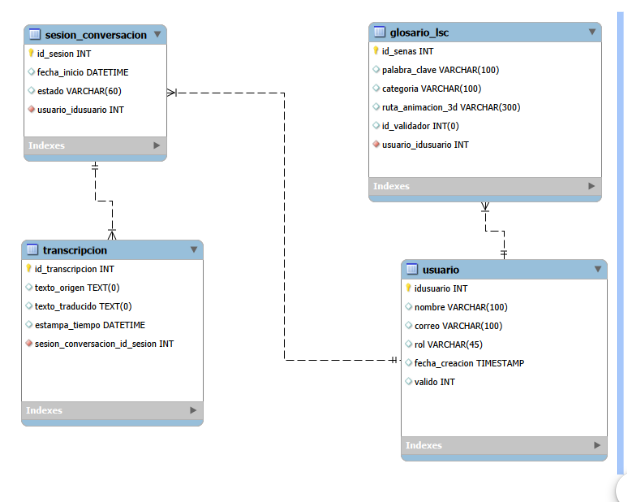

 **INSTITUCIÓN UNIVERSITARIA ITM**

**Facultad de Ingenierías**

**Programa: Ingeniería de Sistemas**

 **ARQUITECTURA DE SOFTWARE II**

**Docente: Jonathan Sánchez Giraldo**

 **ACTIVIDAD DE LA GUÍA DE TRABAJO No. 1**  
                                       **Caso de estudio:** SeñaViva ( Traductor bidireccional de lengua de señas).

**INTEGRANTES Y ROLES:**

**Mateo Orozco Oquendo \- Desarrollador Backend y Arquitecto de Software**   
       **Cristian Mendez Guzman \- Desarrollador Frontend y Encargado de Base de Datos** 

**Medellín,(Antioquia) 30/08/2026** 

**PUNTO 1 — CONTEXTO DEL ESCENARIO (SeñaViva).**

SeñaViva es una aplicación móvil y web de traducción bidireccional en tiempo real entre la Lengua de Señas Colombiana (LSC) y el español oral/escrito. Su propósito es permitir que una persona sorda y una persona oyente sostengan una conversación fluida sin necesidad de un intérprete humano presente: la cámara del dispositivo captura las señas y las convierte en texto y voz, mientras que la voz o el texto del interlocutor oyente se traduce y se representa mediante un avatar 3D que ejecuta las señas correspondientes.

**Problema principal que intenta resolver:**

La comunicación cotidiana entre personas sordas y oyentes depende hoy de la disponibilidad de intérpretes de lengua de señas, un recurso escaso, costoso y que debe agendarse con anticipación. Esto genera una barrera de acceso en escenarios donde la comunicación es inmediata e impredecible: una consulta médica, un trámite bancario, una clase o una entrevista de trabajo. Las alternativas actuales —escribir en papel o en el celular— son lentas e ignoran que para muchas personas sordas la LSC es su lengua materna y el español escrito es una segunda lengua. SeñaViva busca reducir esa dependencia ofreciendo traducción inmediata y portátil.

**Actores principales:**

* **Usuario sordo:** Se comunica en LSC. Inicia sesiones de conversación, recibe el mensaje del oyente mediante el avatar y puede corregir traducciones erróneas.

* **Usuario oyente:** Interlocutor sin conocimiento de LSC (médico, docente, cajero). Habla o escribe y lee la transcripción de las señas.   
* **Intérprete / validador lingüístico:** Perfil experto que revisa traducciones marcadas como incorrectas y aprueba nuevas entradas del glosario.   
* **Administrador del sistema:** Gestiona usuarios, roles, versiones del modelo de reconocimiento y métricas.

**Funcionalidades clave:**

1. ***Traducción señas (texto/voz):*** Captura de video en tiempo real, reconocimiento de la secuencia de señas y salida simultánea en texto en pantalla y voz sintetizada.

2. ***Traducción voz/texto (señas):*** Transcripción del audio del oyente y generación de la secuencia de señas ejecutada por un avatar 3D animado.

3. ***Modo conversación bidireccional:*** Sesión compartida con gestión de turnos y transcripción completa del diálogo, exportable al finalizar.

4. ***Glosario colaborativo y retroalimentación:*** El usuario marca una traducción como incorrecta y propone la corrección; el intérprete la válida para reentrenar el modelo.

**PUNTO 2 — IDENTIFICACIÓN DE PATRONES DE DISEÑO** 

**Patrón Strategy (Comportamiento):**  Aplicaría Strategy para encapsular los distintos algoritmos de traducción que el sistema debe soportar. SeñaViva no ejecuta un único proceso de traducción: el sentido señas → texto requiere un modelo de visión por computador sobre el flujo de la cámara, mientras que el sentido texto →  señas requiere un motor de síntesis que arma la secuencia de animaciones del avatar; a esto se suma que el sistema debe poder trabajar con distintas lenguas de señas (LSC, ASL) y con distintas versiones del modelo según la capacidad del dispositivo. Definiendo una interfaz común EstrategiaTraduccion con implementaciones concretas (SenasATextoLSC, TextoASenasLSC, SenasATextoASL), el contexto de la conversación selecciona e intercambia el algoritmo en tiempo de ejecución sin conocer sus detalles internos. Esto elimina los condicionales anidados y cumple el principio abierto/cerrado: agregar una nueva lengua de señas significa crear una clase nueva, no modificar la lógica existente.

**Patrón Observer (Comportamiento):** Aplicaría **Observer** para propagar los resultados de la traducción en tiempo real hacia los múltiples componentes que deben reaccionar ante ellos. Cuando el motor produce un fragmento traducido, varios elementos del sistema deben actualizarse simultáneamente y de forma independiente: los subtítulos en pantalla del usuario oyente, el avatar 3D, el sintetizador de voz, la transcripción acumulada y el registro en base de datos usado para métricas. Si el motor de traducción llamara directamente a cada uno de estos componentes quedaría fuertemente acoplado a la interfaz y a la persistencia. Con Observer, el motor actúa como sujeto que publica eventos de tipo TraduccionGenerada y cada componente (VistaSubtitulos, AvatarSenas, RepositorioTranscripcion) se suscribe o se da de baja dinámicamente, facilitando un flujo asíncrono y orientado a eventos.

**Patrón Adapter (Estructural):** Aplicaría **Adapter** para integrar los servicios externos heterogéneos de los que depende el sistema sin contaminar el núcleo de la aplicación con sus particularidades. SeñaViva consume bibliotecas de detección de puntos clave de manos y cuerpo (MediaPipe) y motores de reconocimiento automático del habla (Whisper API). Cada uno expone una API distinta, con formatos de entrada y salida propios, y todos son candidatos a ser reemplazados a futuro. Creando interfaces propias del dominio (ReconocedorDeVoz, DetectorDePose) y clases adaptadoras (MediaPipeAdapter, WhisperAdapter) que traducen esas interfaces a las llamadas concretas de cada proveedor, el resto del sistema programa contra el contrato propio y no contra el proveedor. Cambiar de motor de reconocimiento se reduce entonces a escribir un nuevo adaptador sin modificar el núcleo

**PUNTO 3 \- DIAGRAMA UML**

**PUNTO 4 \-  DISEÑO DE BASE DE DATOS WORKBENCH**

**Integración y Explicación**

El modelo de datos en MySQL Workbench soporta operativamente el flujo de SeñaViva y se integra directamente con los patrones orientados a objetos. Las tablas usuario y sesion\_conversacion gestionan los actores y el contenedor de la interacción. Cuando la clase SesionConversacion (contexto de Strategy) ejecuta la traducción hacia el avatar, consulta la tabla glosario\_lsc para obtener las rutas de las animaciones 3D. Asimismo, los adaptadores (Adapter) estandarizan las estructuras provenientes de las librerías externas antes de su procesamiento. Finalmente, al generarse un resultado, SesionConversacion (sujeto en Observer) notifica a RepositorioTranscripcion, el cual guarda de forma asíncrona la entrada en la tabla transcripcion enlazada a la sesión activa mediante su clave foránea. Esto mantiene desacopladas la arquitectura y la persistencia relacional.

**Link del video:** [Video explicativo](https://correoitmedu-my.sharepoint.com/:v:/g/personal/mateoorozco313199_correo_itm_edu_co/IQDhD2dm7bIYSqCDHYMYv0UKAQXrPHHHWmQ0YXKTgh0x0lc?e=TG34JW&nav=eyJyZWZlcnJhbEluZm8iOnsicmVmZXJyYWxBcHAiOiJTdHJlYW1XZWJBcHAiLCJyZWZlcnJhbFZpZXciOiJTaGFyZURpYWxvZy1MaW5rIiwicmVmZXJyYWxBcHBQbGF0Zm9ybSI6IldlYiIsInJlZmVycmFsTW9kZSI6InZpZXcifX0%3D)

# **BIBLIOGRAFÍA**

* **Gamma, E., Helm, R., Johnson, R., & Vlissides, J.** (1994). *Design Patterns: Elements of Reusable Object-Oriented Software*. Addison-Wesley.  
   *(Fuente teórica principal para la justificación e implementación de los patrones de diseño Strategy, Adapter y Observer en el diagrama UML de clases)*.  
    
* **Instituto Nacional para Sordos (INSOR).** (2023). *Caracterización de la Lengua de Señas Colombiana (LSC) y acceso a la información en Colombia*. Ministerio de Educación Nacional. Recuperado de [https://www.insor.gov.co](https://www.google.com/search?q=https://www.insor.gov.co)  
  *(Fuente institucional utilizada para contextualizar la problemática social, los actores principales y las barreras de comunicación del escenario SeñaViva)*.  
    
* **MySQL Workbench Documentation.** (2024). *Relational Database Design and Entity-Relationship Modeling*. Oracle Corporation. Recuperado de [https://dev.mysql.com/doc/workbench/en/](https://dev.mysql.com/doc/workbench/en/)  
  *(Guía técnica utilizada para el diseño del modelo Entidad-Relación EER de 4 tablas y la definición de claves primarias y foráneas)*.  
    
* **Refactoring Guru.** (s.f.). *Patrones de Diseño: Strategy, Adapter y Observer*. Recuperado de [https://refactoring.guru/es/design-patterns/catalog](https://refactoring.guru/es/design-patterns/catalog)  
  *(Catálogo de referencia para el análisis de los patrones de comportamiento y estructura aplicados al motor de traducción)\[Catálogo de referencia para el análisis de los patrones de comportamiento y estructura aplicados al motor de traducción \].*  
    
* ***Google. (s.f.). MediaPipe** Solutions guide. Google AI Edge. Recuperado el 30 de agosto de 2026, de [https://developers.google.com/edge/mediapipe/solutions/guide](https://developers.google.com/edge/mediapipe/solutions/guide)*  
    
* ***OpenAI**. (s.f.). Speech to text. OpenAI Platform Documentation. Recuperado el 30 de agosto de 2026, de [https://platform.openai.com/docs/guides/speech-to-text](https://platform.openai.com/docs/guides/speech-to-text)*